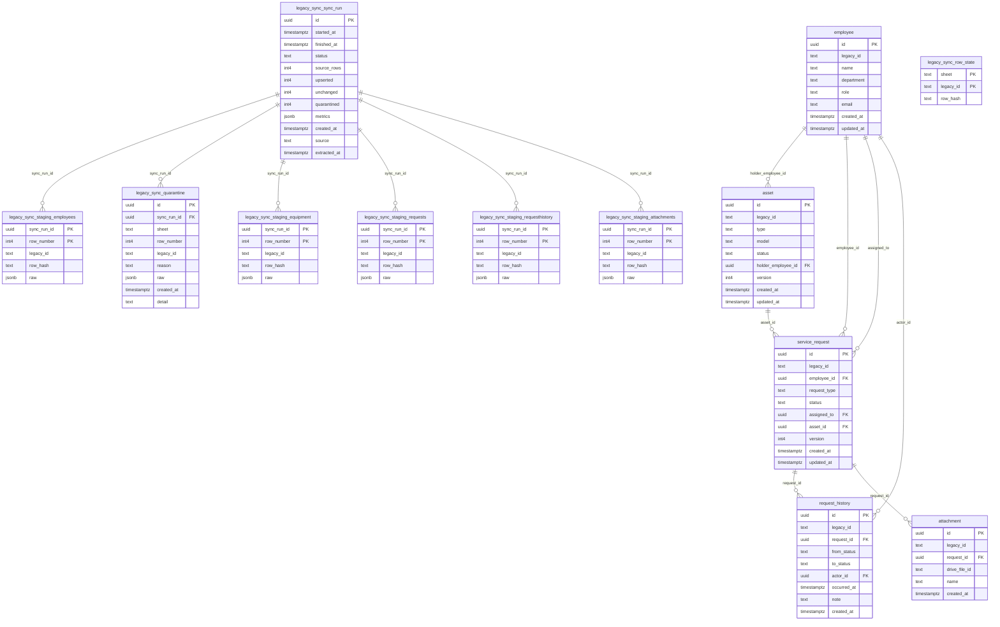

# Database Entity-Relationship Diagram (ERD)

> ⚠️ **Auto-generated file** directly from PostgreSQL ground-truth catalog.
> Run `pnpm db:diagram` to regenerate after migrations.
> Or view directly in browser via: `open docs/architecture/database-erd.html`

## Summary of Tables

| Schema        | Table Name               | Columns | Foreign Keys |
| :------------ | :----------------------- | :------ | :----------- |
| `legacy_sync` | `quarantine`             | 9       | 1            |
| `legacy_sync` | `row_state`              | 3       | 0            |
| `legacy_sync` | `staging_attachments`    | 5       | 1            |
| `legacy_sync` | `staging_employees`      | 5       | 1            |
| `legacy_sync` | `staging_equipment`      | 5       | 1            |
| `legacy_sync` | `staging_requesthistory` | 5       | 1            |
| `legacy_sync` | `staging_requests`       | 5       | 1            |
| `legacy_sync` | `sync_run`               | 12      | 0            |
| `public`      | `asset`                  | 9       | 1            |
| `public`      | `attachment`             | 6       | 1            |
| `public`      | `employee`               | 8       | 0            |
| `public`      | `request_history`        | 9       | 2            |
| `public`      | `service_request`        | 10      | 3            |
