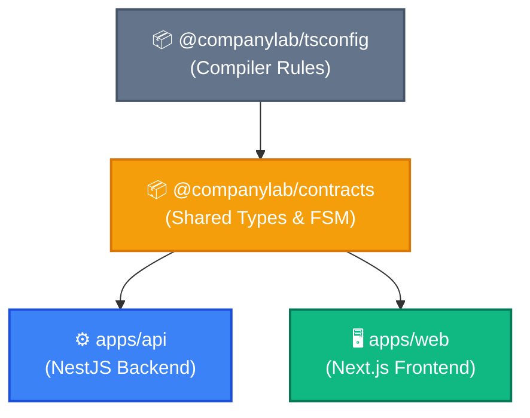

# CompanyLab ERP Monorepo & Architecture Guide

This document captures the engineering patterns, mental models, build mechanics, and operational best practices established for the **CompanyLab ERP** monorepo.

---

## 1. Monorepo Topology & Package Roles

The repository uses **pnpm workspaces** orchestrated by **Turborepo**. Each package has a distinct architectural responsibility:

| Package                     | Category             | Primary Tooling                                    | Responsibility                                                                                                        |
| --------------------------- | -------------------- | -------------------------------------------------- | --------------------------------------------------------------------------------------------------------------------- |
| **`@companylab/tsconfig`**  | Shared Config        | TypeScript                                         | Base TypeScript configuration (`base.json`, `nestjs.json`, `nextjs.json`) ensuring strict typing across all projects. |
| **`@companylab/contracts`** | Shared Specification | `tsup` (esbuild), Zod, Vitest                      | The single source of truth for domain enums, Zod validation schemas, FSM workflow rules, and API response types.      |
| **`@companylab/api`**       | Backend Application  | NestJS 10, TypeORM, PostgreSQL 16                  | Modular monolith backend exposing REST endpoints, managing database transactions, locking, and data ingestion.        |
| **`@companylab/web`**       | Frontend Application | Next.js 15 (App Router), React Query, Tailwind CSS | Back-office web interface providing dashboards, request approval queues, and asset lifecycle tracking.                |



---

## 2. Build Outputs Demystified

A common misconception is that building JavaScript/TypeScript projects always produces a single monolithic `dist.js` bundle. In reality, each artifact has a tailored build output strategy:

### A. Shared Library (`@companylab/contracts`)

- **Tool**: `tsup src/index.ts --format cjs,esm --dts`
- **Output**: `packages/contracts/dist/`
  - `dist/index.js` (CommonJS module for Node.js / NestJS)
  - `dist/index.mjs` (ES Module for modern web bundlers)
  - `dist/index.d.ts` (Type definitions)
- **Rationale**: Libraries meant for import should be condensed to minimal entry points for fast resolution and tree-shaking.

### B. Backend Service (`@companylab/api`)

- **Tool**: `nest build` (TypeScript compiler `tsc`)
- **Output**: `apps/api/dist/` (Full mirrored directory tree)
  - `dist/main.js`, `dist/app.module.js`, `dist/modules/*`
- **Rationale**: Node.js backend runtimes execute via `node dist/main.js` and rely on runtime module resolution (`require()`). Bundling entire backends into a single file frequently breaks TypeORM reflection metadata, C++ native drivers (`pg-native`), and dynamic file loaders.

### C. Frontend Web App (`@companylab/web`)

- **Tool**: `next build`
- **Output**: `apps/web/.next/` (Chunked & Static Ecosystem)
  - `.next/static/chunks/`: Tens of hashed chunk files (`812-xxx.js`, `framework-xxx.js`) to maximize browser caching and minimize initial payload (Core Web Vitals / LCP).
  - `.next/server/`: Server components and route execution runtimes.
  - `.next/*-manifest.json`: Routing and static prerender specifications.
- **Rationale**: Web apps must never ship as a single 5MB bundle, which causes poor mobile network performance and blank-screen delays.

---

## 3. The "Contract" Architecture Pattern

`@companylab/contracts` is **not** a controller (which handles HTTP routes) and **not** a config file (which defines runtime flags). It is a **Domain Specification Package** implementing _Design by Contract_:

1. **Enums (`src/enums/`)**: Canonical statuses (`ServiceRequestStatus`, `AssetStatus`, `UserRole`, `QuarantineReason`). Prevents string casing mismatches.
2. **Finite State Machine (`src/fsm/`)**: Definitive transition rules (`isTransitionAllowed()`, `getAllowedTransitionsForStatus()`). Both web (UI button visibility) and API (route guards) evaluate the exact same business logic.
3. **Validation Schemas (`src/schemas/`)**: Zod schemas (`CreateServiceRequestSchema`, `TransitionRequestSchema`) inferring runtime validation and static TypeScript DTOs.
4. **Response Models (`src/responses/`)**: Response contracts (`ServiceRequestItem`, `DashboardStatsResponse`) guarantee that client components know the exact payload shape returned by the API.

### Multi-Language Equivalents

In non-TypeScript stacks (e.g. Java Spring Boot backend + React frontend):

- Contract is maintained via **OpenAPI/Swagger (`openapi.json`)** with tools like `openapi-typescript` generating client types.
- Or schema-first via **Protobuf (`.proto`)** for gRPC, or **GraphQL Schemas**.
- Or enforced in CI via **Consumer-Driven Contract Testing** (Pact, Spring Cloud Contract).

---

## 4. Turborepo Orchestration & Caching Guide

Turborepo is a **Task Orchestrator**, not a compiler. It reads `turbo.json` and package relationships to manage scheduling, parallelism, and caching.

### Essential Rules in `turbo.json`

```json
{
  "$schema": "https://turbo.build/schema.json",
  "tasks": {
    "build": {
      "dependsOn": ["^build"],
      "env": ["NEXT_PUBLIC_API_URL"],
      "outputs": [".next/**", "!.next/cache/**", "dist/**"]
    },
    "dev": {
      "cache": false,
      "persistent": true
    }
  }
}
```

1. **The Caret Syntax (`^`) in `dependsOn`**:
   - `"^build"`: Build all upstream dependencies (e.g., `@companylab/contracts`) before running this package's build.
   - `"build"` (without `^`): Run the `build` task of the _same_ package before the current task.
2. **The `outputs` Contract**:
   - On cache hits, Turborepo **replays files listed in `outputs`** without executing the command.
   - If an output directory (e.g., `dist/**`) is omitted from `outputs`, cache hits will report success but the compiled files will be missing from disk, causing deployment failures.
3. **Environment Invalidation (`env`)**:
   - Client-side variables (like `NEXT_PUBLIC_API_URL`) baked into JS bundles during build must be declared in `env`. This ensures that changing the API URL invalidates the cache and forces a fresh build.
4. **Dev Tasks**:
   - `"cache": false`: Prevents stale cache during active local development.
   - `"persistent": true`: Tells Turborepo that the task is a long-running watcher process that should not be terminated automatically.

---

## 5. Real-World Gotchas & Lessons Learned

### Gotcha: Relative `outDir` in Monorepo Tsconfig Inheritance

- **Symptom**: Running `pnpm build` produced no `apps/api/dist/` directory, while an unexpected `packages/tsconfig/dist/` directory appeared.
- **Root Cause**: `apps/api/tsconfig.json` extended `@companylab/tsconfig/nestjs.json`. Because `nestjs.json` specified `"outDir": "./dist"`, TypeScript resolved the path relative to the configuration file's physical directory in `packages/tsconfig/`.
- **Fix**: Always explicitly declare `"outDir": "./dist"` in leaf package `tsconfig.json` files when inheriting from shared configs in other workspace directories:
  ```json
  // apps/api/tsconfig.json
  {
    "extends": "@companylab/tsconfig/nestjs.json",
    "compilerOptions": {
      "baseUrl": "./",
      "outDir": "./dist"
    }
  }
  ```

### Gotcha: Optimistic & Pessimistic Concurrency

- When transitioning requests (e.g., assigning a laptop to an employee):
  - **Pessimistic lock** (`pessimistic_write`) locks the database row during the transaction.
  - **Optimistic check** (`version: request.version + 1`) ensures clients never overwrite concurrent updates made by another operator.
  - Contract defines `version: z.number().int().min(1)` in `TransitionRequestSchema`.
