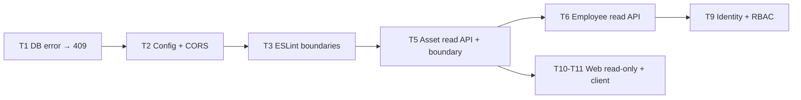

# Handover: Review CompanyLabERP

- **Ngày**: 2026-10-19
- **Repo**: `/Users/nguyenanhtuong.vn/Proj/CompanyLabERP`
- **Branch lúc review**: `ai-agent/web-dashboard-and-db-tools` (HEAD `53a5892`)
- **Phạm vi**: chỉ đọc (read-only review), chưa sửa gì trong repo này
- **Mục tiêu**: cải thiện chất lượng code + lộ trình học BE / fullstack

> [!WARNING]
> Branch đang có thay đổi chưa commit: `apps/web/app/page.tsx` (modified) và các thư mục untracked
> `apps/web/components/{dialogs,layout,modules,ui}/`, `apps/web/lib/types/`.
> Hãy commit hoặc stash trước khi bắt đầu task mới.

---

## 1. Đính chính các nhận xét trước trong thread

Các nhận xét trước đó có vài chỗ đoán mà chưa đọc code. Sau khi kiểm tra:

| Nhận xét cũ                                              | Thực tế trong code                                                                                                                                                                                                                                                            | Kết luận                                                   |
| :------------------------------------------------------- | :---------------------------------------------------------------------------------------------------------------------------------------------------------------------------------------------------------------------------------------------------------------------------- | :--------------------------------------------------------- |
| "Cần thêm transaction + locking cho `TransitionService`" | [transition.service.ts](file:///Users/nguyenanhtuong.vn/Proj/CompanyLabERP/apps/api/src/modules/service-request/application/transition.service.ts) **đã có** `dataSource.transaction`, `pessimistic_write` lock trên request + asset, kiểm tra version, ghi `request_history` | ❌ Sai, đã làm rồi                                         |
| "Request chuyển sang `ALLOCATED`"                        | Không có status này. Cấp phát = request type `ALLOCATION` chuyển sang `COMPLETED`                                                                                                                                                                                             | ❌ Sai tên                                                 |
| "Frontend chủ yếu dùng mock data"                        | `ITServiceView` **đã gọi API thật** qua React Query. Chỉ `PeopleView`, `ProjectsView`... là dữ liệu hard-code                                                                                                                                                                 | ⚠️ Đúng một phần                                           |
| "Nên viết Asset CRUD (tạo/sửa)"                          | ADR-0001: đang ở **Phase A (Shadow)**, Google Sheets là nguồn dữ liệu chính (system of record). Endpoint ghi bị chặn cố ý (`403 READ_ONLY_SHADOW`)                                                                                                                            | ❌ Ghi dữ liệu lúc này sẽ vi phạm ADR. Chỉ làm **API đọc** |
| "Cần thêm Swagger / CI"                                  | Swagger đã có ở `/api/docs`; CI đã chạy typecheck, test, check schema drift, build                                                                                                                                                                                            | ❌ Đã có                                                   |
| "Chưa có module `identity`"                              | Đúng, chưa có                                                                                                                                                                                                                                                                 | ✅ Đúng                                                    |
| "`AssetModule`/`OrganizationModule` chỉ có entity"       | Đúng                                                                                                                                                                                                                                                                          | ✅ Đúng                                                    |

---

## 2. Những điểm đã làm tốt (giữ nguyên)

- Ràng buộc dữ liệu đặt ngay trong PostgreSQL: CHECK cho holder/status, partial unique index `uq_asset_one_laptop_per_holder`, FK đầy đủ.
- FSM dùng chung trong `@companylab/contracts`, có test (`fsm.spec.ts`).
- Endpoint ghi chặn theo kiểu **fail-closed**, có test chặn cả header giả mạo ([controller.spec](file:///Users/nguyenanhtuong.vn/Proj/CompanyLabERP/apps/api/src/modules/service-request/http/service-request.controller.spec.ts)).
- `RequestQueryDto` đã validate enum, giới hạn `limit`, có `ValidationPipe` với `whitelist` + `forbidNonWhitelisted`.
- Có ADR rõ ràng, migration-only (`synchronize: false`), có script kiểm tra schema drift.

---

## 3. Vấn đề đã kiểm chứng và việc cần làm

Ưu tiên tuân theo các quy tắc bắt buộc trong `AGENTS.md` của repo và ADR-0001 (Phase A chỉ đọc).

### P0: Độ đúng đắn và hạ tầng (task nhỏ, nên làm trước)

#### T1. Đổi lỗi ràng buộc DB thành HTTP 409

- **Vấn đề**: Khi cấp phát, đoạn `existingLaptop` được đọc **không lock**. Nếu có race condition, partial unique index sẽ chặn lại, nhưng lỗi Postgres `23505` sẽ bị trả ra thành **500** thay vì 409.
- **Việc cần làm**: Viết global exception filter: `QueryFailedError` với code `23505` (unique) / `23514` (check) / `23503` (FK) → `409 Conflict`, kèm message dễ đọc.
- **Test**: bắt buộc có test đỏ trước khi sửa (quy tắc trong AGENTS.md). Có thể dùng `@electric-sql/pglite` hoặc `TEST_DATABASE_URL` sẵn có.
- 🎓 _Học được_: Exception Filter của NestJS, mã lỗi Postgres, ràng buộc DB làm lớp phòng thủ cuối.

#### T2. Validate cấu hình và bỏ secret hard-code

- **Vấn đề**: [app.module.ts](file:///Users/nguyenanhtuong.vn/Proj/CompanyLabERP/apps/api/src/app.module.ts) đọc thẳng `process.env` với giá trị mặc định `clt_password_local`. Đã import `ConfigModule` nhưng không dùng. `app.enableCors()` đang mở cho mọi origin.
- **Việc cần làm**: Viết zod schema cho env (zod đã có sẵn), `TypeOrmModule.forRootAsync` + `ConfigService`, thiếu biến thì dừng ngay khi khởi động (fail fast). Đưa danh sách CORS origin vào env.
- 🎓 _Học được_: Cấu hình theo 12-factor, dynamic module (`forRootAsync`).

#### T3. Lint thực ra đang không chạy (mâu thuẫn giữa code và ADR)

- **Vấn đề**: Script lint của api là `"lint": "echo 'api linted'"` và cả repo không có file cấu hình ESLint nào. Trong khi ADR-0002 ghi: _"Module boundaries are enforced by lint rules"_.
- **Việc cần làm**: Thêm ESLint (flat config) + `no-restricted-imports` hoặc `eslint-plugin-boundaries` để cấm import sâu chéo giữa các module. Cài thêm package nào thì làm theo skill `dependency-guard`.
- 🎓 _Học được_: Giữ ranh giới kiến trúc bằng công cụ, không chỉ bằng quy ước.

#### T4. Logging

- **Vấn đề**: `pino` và `pino-http` đã có trong dependencies nhưng **không được dùng ở đâu cả**. `main.ts` vẫn dùng `console.log`.
- **Việc cần làm**: Gắn pino-http làm middleware (log có cấu trúc, có request id), hoặc gỡ bỏ dependency thừa.

### P1: Các tính năng đọc (hợp lệ trong Phase A)

#### T5. Asset read API + đóng ranh giới module

- **Vấn đề**:
  - `AssetModule` / `OrganizationModule` export `TypeOrmModule`, tức là để lộ repository ra ngoài. ADR-0002 yêu cầu chỉ giao tiếp qua service được export.
  - `TransitionService` (module service-request) thao tác trực tiếp `AssetEntity` qua `em`.
- **Việc cần làm**:
  - `AssetService` + `AssetController`: `GET /api/assets` (lọc `type`/`status`, phân trang), `GET /api/assets/:idOrLegacyId` (kèm người đang giữ + các request liên quan).
  - Chuyển logic gán/thu hồi tài sản vào `AssetService.assign(em, assetId, employeeId)` / `release(em, ...)`. Nhận `EntityManager` để vẫn chạy chung transaction.
  - Chỉ export `AssetService`, không export `TypeOrmModule`.
  - Test hiện có trong `transition.service.spec.ts` phải vẫn pass.
- 🎓 _Học được_: Bounded context, chia sẻ transaction giữa các service, QueryBuilder.

#### T6. Employee read API

- Làm tương tự T5 cho `OrganizationModule`: `GET /api/employees` (lọc theo phòng ban, tìm kiếm tên/email bằng `ILIKE`).

#### T7. Gom code tiện ích bị lặp

- **Vấn đề**: Regex kiểm tra UUID bị **lặp và không thống nhất**. `service-request.service.ts` dùng bản chặt (`[1-5]…[89ab]`), `transition.service.ts` dùng bản lỏng. Logic "tìm theo `id` hoặc `legacyId`" cũng bị lặp.
- **Việc cần làm**: Tách ra helper dùng chung (`isUUID` của class-validator + hàm `byIdOrLegacyId()`).

#### T8. Truy vấn dashboard

- **Vấn đề**: `getDashboardStats` hard-code chuỗi status trong raw SQL thay vì dùng enum. `COUNT(*)` trả về `bigint`, driver `pg` sẽ chuyển thành **string**.
- **Việc cần làm**: Truyền enum dưới dạng tham số, ép kiểu `::int`, rồi kiểm tra lại type `DashboardStatsResponse` trong contracts có khớp không.

### P2: Chuẩn bị cho Phase B (Identity)

#### T9. `IdentityModule` theo ADR-0005

- Xác thực Firebase ID token (`firebase-admin`, là dependency mới nên làm theo `dependency-guard`) → tìm `employee` theo email → lấy role từ DB (không chỉ tin custom claims).
- Global `AuthGuard`, decorator `@CurrentUser()`, `RolesGuard`.
- Có thể **áp dụng ngay cho các endpoint đọc** (ví dụ EMPLOYEE chỉ xem request của chính mình) mà không vi phạm Phase A.
- Endpoint transition **giữ nguyên 403** cho tới khi chuyển Phase B và có outbox (ADR-0001).
- 🎓 _Học được_: Xác thực token, Guard, RBAC, phân quyền theo từng bản ghi.

### Frontend / Fullstack

#### T10. UI phải phản ánh chế độ chỉ đọc

- `lib/api-client.ts` có `transitionRequest()` nhưng hàm này **luôn nhận 403**. Nên ẩn/disable các nút thao tác ghi dựa trên `mode: 'READ_ONLY_SHADOW'` mà API dashboard trả về, kèm banner "Cập nhật trên Google Sheet".

#### T11. Chuẩn hoá API client

- Các hàm fetch đang lặp code. Gom lại thành `apiFetch<T>()` có lỗi typed (status + message), cộng thêm một query key factory dùng cho React Query.
- Khi có T5/T6: thêm `useAssets`, `useEmployees`.

#### T12. Lint cho web và các màn hình prototype

- Web chạy `next lint` nhưng không có file cấu hình ESLint.
- `PeopleView`, `ProjectsView`, `MyWorkView` dùng dữ liệu hard-code và không có API hay ADR nào đứng sau. Cần quyết định: giữ làm prototype (gắn nhãn rõ ràng) hay bỏ khỏi phạm vi.

---

## 4. Câu hỏi mở (cần quyết định trước khi code)

1. **Request REPAIR**: workflow không bao giờ chuyển asset sang `MAINTENANCE`. Khi request REPAIR chuyển sang `IN_PROGRESS`/`COMPLETED`, asset nên đổi trạng thái thế nào? → Cần viết ADR mới (skill `write-adr`).
2. **Thời điểm chuyển Phase A → B**: ADR yêu cầu N ngày liên tiếp không có chênh lệch khi đối soát dữ liệu (reconciliation). N là bao nhiêu và ai sign-off?
3. Các module People / Projects có nằm trong lộ trình không, hay chỉ là mockup UI?

---

## 5. Thứ tự đề xuất



Mỗi task nên làm trên **một branch + một PR** riêng, commit theo Conventional Commits (`fix(api): ...`, `feat(asset): ...`).

## 6. Lệnh kiểm tra (theo README/CI của repo)

```bash
pnpm install --frozen-lockfile
pnpm db:up && pnpm db:migrate
pnpm --filter @companylab/contracts build
pnpm typecheck
pnpm --filter @companylab/contracts test
pnpm --filter @companylab/api test --runInBand
pnpm db:check-drift
pnpm build
```

---

## 7. Thay đổi đã làm ở repo `HTML5-mini-game-2` (không liên quan ERP)

- Tạo symlink `refer/CompanyLabERP → /Users/nguyenanhtuong.vn/Proj/CompanyLabERP`.
- Thêm `refer/` vào `.gitignore` (chưa commit).
- Muốn hoàn tác: `rm refer/CompanyLabERP && rmdir refer` rồi revert phần thay đổi trong `.gitignore`.
